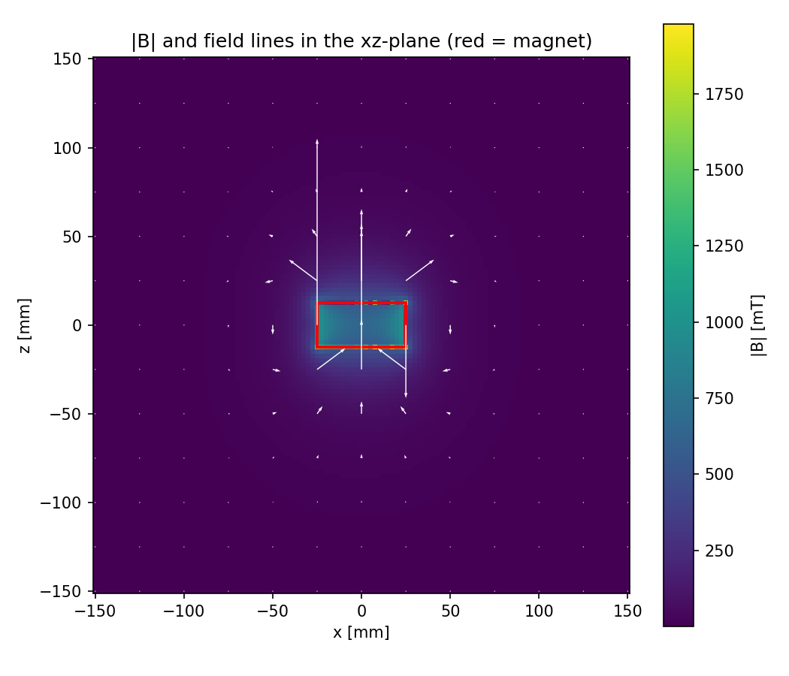
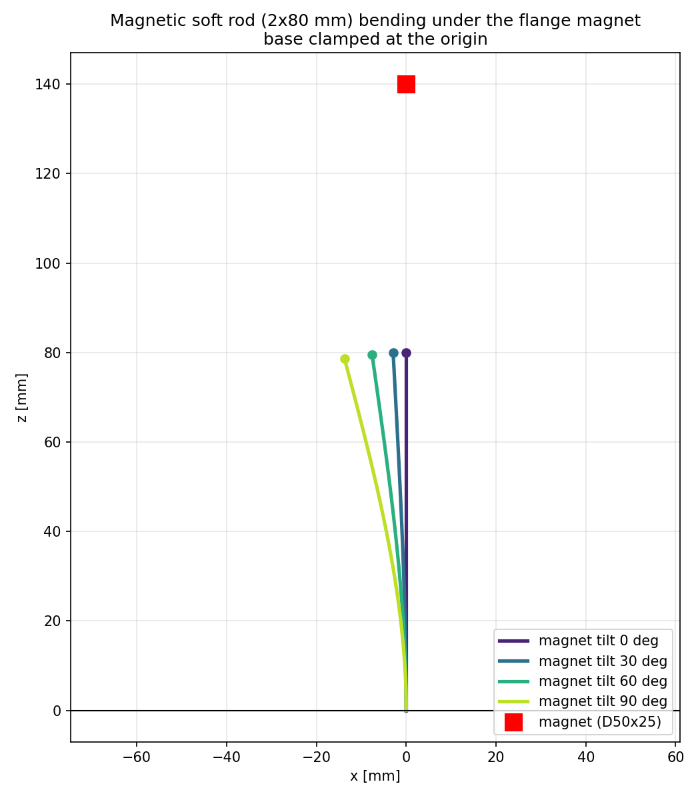
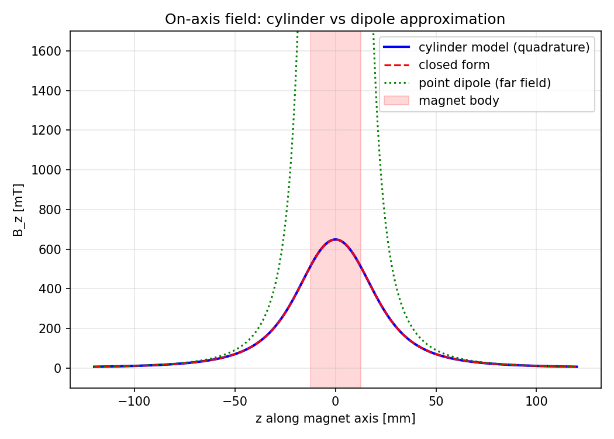
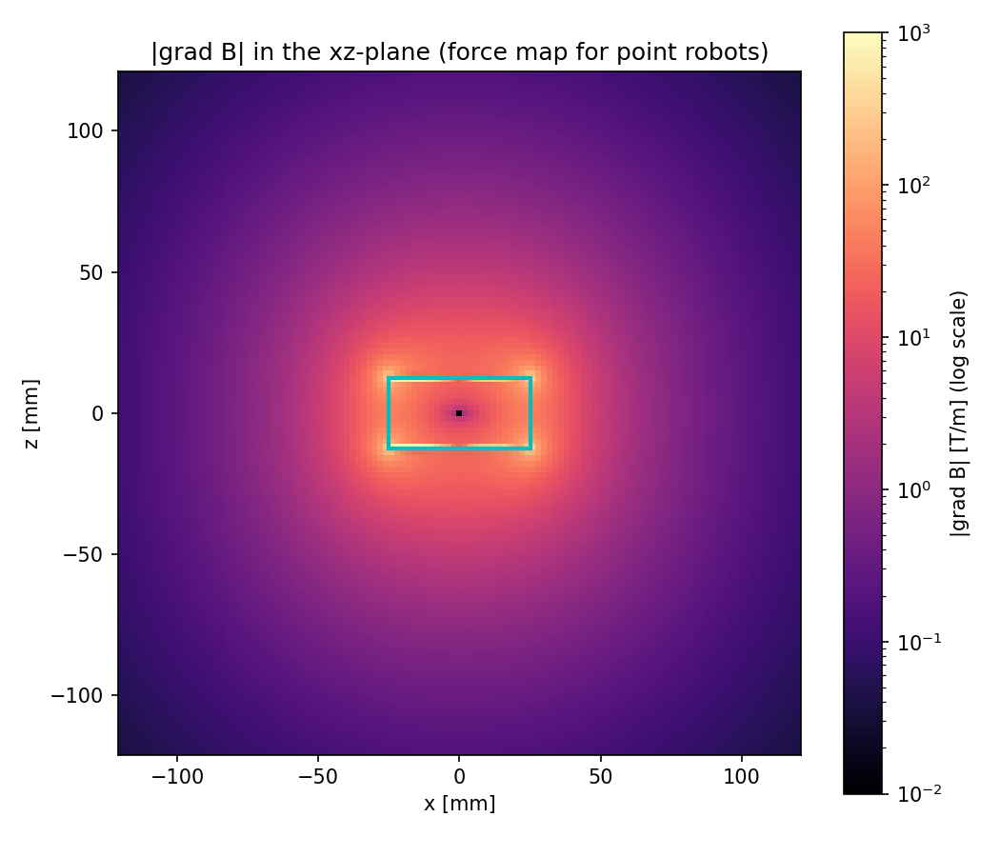
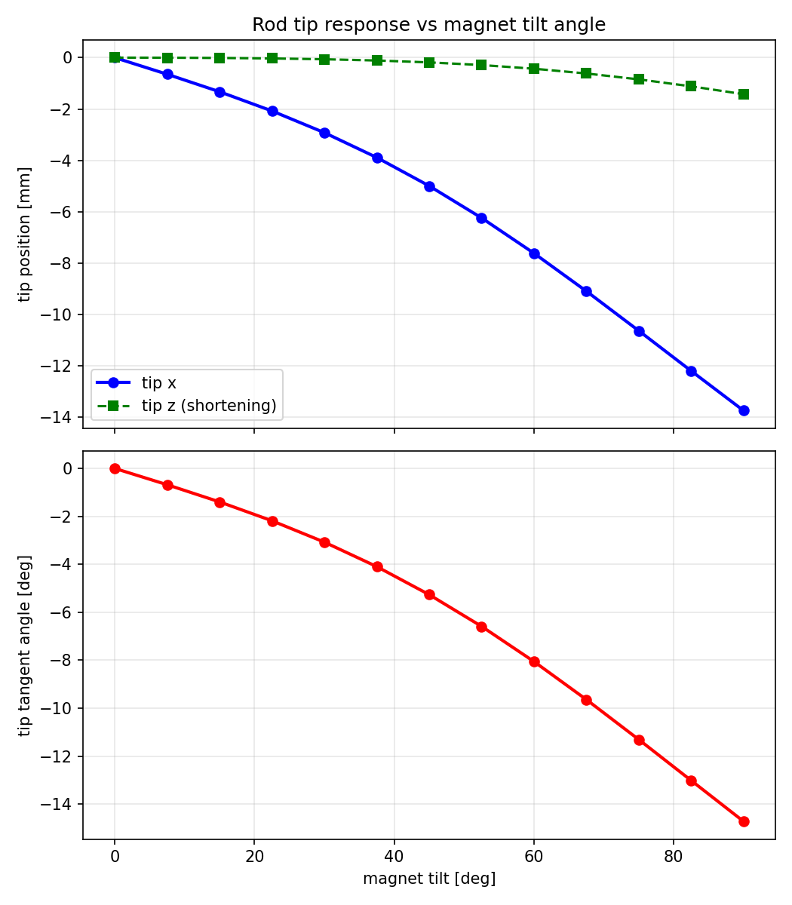

# Magnetic Robot Manipulation Simulation

ROS 2 (Humble) simulation framework for **magnetic manipulation of soft continuum
robots and microrobots** using a permanent magnet held by an **AUBO i5** robot
arm, targeting medical applications (magnetic catheters, intravascular
microrobots in fluid-filled vessel phantoms).

The magnetic field is computed from an **exact analytical model of a uniformly
magnetized cylinder** (magnetic-charge model with Gaussian quadrature) — not a
point-dipole approximation — so the physics remains accurate at the working
distance of 30–150 mm from a D50×25 mm N52 magnet.

| Field of the flange magnet | Continuum rod response |
|---|---|
|  |  |

## Overview

The simulated cell consists of:

- **AUBO i5 arm** with an **N52 cylindrical magnet (D50×25 mm, Br = 1.45 T)**
  mounted on the flange (60 mm standoff);
- a transparent **vessel phantom** (horizontal tube, glycerol-water fluid,
  η ≈ 0.004 Pa·s — blood-like viscosity);
- a **magnetic soft continuum rod** (Ø2 mm, 80 mm, silicone composite,
  E ≈ 5 MPa, m = 1.5·10⁻³ A·m²) clamped at the vessel inlet — catheter scale;
- **point magnetic robots** (1.5 mm radius dipoles) drifting in the fluid.

Moving the arm with the joint sliders changes the magnet pose → the rod bends
and the point robots move in real time in RViz.

## Architecture

```
joint_state_publisher_gui ──/joint_states──► robot_state_publisher ──/tf──┐
                                                                          ▼
                              continuum_sim_node (magnetic_robots_sim)
                              ┌────────────────────────────────────────────┐
                              │ TF: world → magnet_link, rod_link          │
                              │   ↓                                        │
                              │ CylinderMagnet: B(x), ∇B(x)  (exact)       │
                              │   ↓                                        │
                              │ Cosserat rod: warm-started shooting solver │
                              │ Point robots: overdamped dipole dynamics    │
                              │   ↓                                        │
                              │ MarkerArray / PoseStamped / PoseArray      │
                              └────────────────────────────────────────────┘
                                          │ /magnetic_sim/*
                                          ▼
                                       RViz2
```

### Packages

| Package | Description |
|---|---|
| `magnetic_field_model` | Exact field of a uniformly magnetized cylinder (charged-caps quadrature), dipole model, field gradient, force/torque helpers. 18 unit tests. |
| `continuum_rod_model` | Quasi-static Cosserat rod shooting solver with load continuation and real-time warm start (cached shooting Jacobian + Broyden updates, ~100–200 ms/solve). 16 unit tests. |
| `magnetic_robots_description` | URDF/xacro scene (arm + magnet + vessel + rod base frame), launch files, RViz config. |
| `magnetic_robots_sim` | Closed-loop simulation node, parameters, launch files. |

## Physics

**Magnet field.** The cylinder is modeled as two charged end caps with magnetic
surface charge density σ = M·n; the field is integrated numerically
(Gaussian quadrature, 16×32 nodes). Validated against the closed-form on-axis
solution; the dipole approximation is provided for far-field use but deviates
by ≈30 % at 50 mm:



**Continuum rod.** Quasi-static Cosserat equilibrium ODEs along the rod arc
length, integrated by shooting: unknown clamped-end wrench (f₀, m₀) is found
by Newton iteration with load continuation (λ: 0→1). Magnetic loading per unit
length: distributed force `f = ∇(m·B)` and torque `τ = m × B` with the
magnetization along the rod axis.

**Point robots.** Overdamped magnetic dipoles in viscous fluid:
`m ∥ B`, `F = ∇(m·B)`, `v = F / (6πηr)` (Stokes drag), confined inside the
vessel tube.

**Force map** driving the point robots (field gradient):



**Rod tip response** to magnet tilt (sweep used for parameter tuning):



## Requirements

- Ubuntu 22.04, ROS 2 Humble (`ros-humble-desktop`)
- Python 3.10 with `numpy`, `scipy` (tested: numpy 1.21, scipy 1.8)
- `python3-colcon-common-extensions`, `python3-vcstool`
- `matplotlib` (optional, for the plotting scripts)

## Installation

```bash
git clone https://github.com/serezhinVM/magnetic-robot-manipulation.git
cd magnetic-robot-manipulation

# fetch the external dependency (aubo_description)
vcs import src < .repos

# build the workspace
colcon build
source install/setup.bash
```

## Usage

```bash
ros2 launch magnetic_robots_sim sim.launch.py
```

An RViz window opens with the arm, the magnet hovering above the vessel, the
blue continuum rod and three colored point robots. A `joint_state_publisher_gui`
window provides sliders for the six arm joints — move them to steer the magnet;
the rod and robots respond immediately (physics update ≈ 5 Hz).

The sliders start in a demo pose (magnet 11 cm above the vessel, pointing down),
so the rod is bent (~5 mm tip deflection) right after launch.

Headless variant (no RViz/GUI, for quick checks and CI):

```bash
ros2 launch magnetic_robots_sim sim_headless.launch.py
```

### Published topics

| Topic | Type | Content |
|---|---|---|
| `/magnetic_sim/markers` | `visualization_msgs/MarkerArray` | Rod tube, rod tip, point robots, field direction arrow |
| `/magnetic_sim/rod_tip` | `geometry_msgs/PoseStamped` | Rod tip pose |
| `/magnetic_sim/point_robots` | `geometry_msgs/PoseArray` | Point robot positions |

### Main parameters (`config/sim_params.yaml`)

| Parameter | Default | Meaning |
|---|---|---|
| `rate` | 5.0 Hz | Physics update rate |
| `magnet.radius` / `magnet.length` / `magnet.remanence` | 0.025 / 0.025 / 1.45 | N52 cylinder geometry and Br [T] |
| `rod.length` / `rod.diameter` | 0.08 / 0.002 m | Rod geometry |
| `rod.young_modulus` | 5·10⁶ Pa | Silicone composite |
| `rod.moment` | 1.5·10⁻³ A·m² | Total magnetic moment of the rod |
| `points.count` / `points.radius` / `points.moment` | 3 / 0.0015 m / 10⁻⁶ A·m² | Point robots |
| `points.viscosity` | 0.004 Pa·s | Fluid viscosity |
| `vessel.center` / `vessel.radius` / `vessel.half_length` | — | Tube confinement |

> **Note:** launch files and configs are read from `install/` — re-run
> `colcon build` after editing anything in `src/`.

## Validation

34 unit tests (`colcon test`):

- **Magnetic field (18):** on-axis field vs closed-form solution (1e−12),
  dipole far-field limit, gradient symmetry, quadrature convergence,
  force/torque consistency.
- **Continuum rod (16):** Euler–Bernoulli bending vs analytic deflection,
  exact circular arc, first integral of the magnetic elastica (1e−8),
  magnetic alignment, gradient force on a dipole rod.

```bash
colcon test --packages-select magnetic_field_model continuum_rod_model
colcon test-result --verbose
```

## Roadmap

1. ✅ Scene and arm visualization in RViz (URDF/xacro, launch, RViz config)
2. ✅ Magnetic field library (exact cylinder + dipole, validated)
3. ✅ Cosserat rod model (shooting solver, validated)
4. ✅ ROS 2 simulation node (TF → field → robots → RViz, warm-started ~5 Hz)
5. 🔄 Control: inverse problem — drive the rod tip to a target via arm joints
6. ⬜ Point microrobots: multi-robot control, collisions
7. ⬜ Integration: MoveIt 2 / MuJoCo contacts, FEMM/COMSOL field validation

## Current limitations

- Uniform magnetization of the cylinder; ferromagnetic arm steel may distort
  the real field near the wrist (to be validated experimentally);
- Quasi-static rod model (no rod inertia/fluid coupling); no rod–wall contact;
- Point robots: pure Stokes drag, no particle–particle or particle–wall
  collision forces yet;
- Field validation against a physical magnet/Hall probe is planned.

## License

MIT — see [LICENSE](LICENSE). The external `aubo_description` package is
fetched separately and keeps its own license.

## Citation

If you use this framework in your research, please cite:

```bibtex
@software{magnetic_robot_manipulation,
  author  = {Vladimir},
  title   = {Magnetic Robot Manipulation Simulation},
  year    = {2026},
  url     = {https://github.com/serezhinVM/magnetic-robot-manipulation}
}
```
